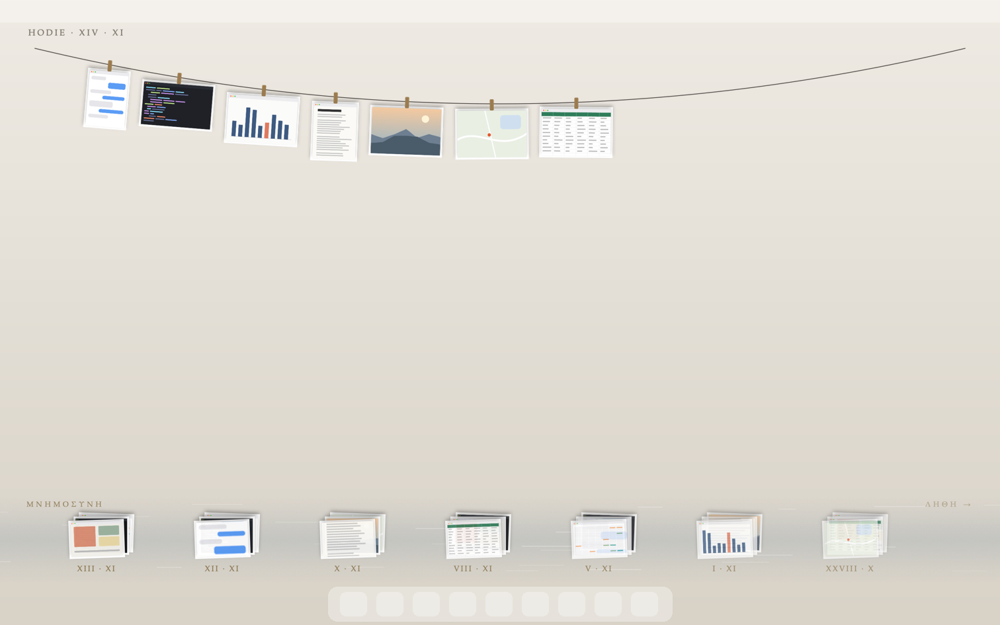

# 晾衣绳 · Clothesline

*A quiet place for the screenshots you didn't drag away.* · [English](#english)



在 Mac 上按 `⌘⇧4` 截图后，截图只会在右下角停留几秒。没来得及拖走，它就落在桌面上。一天天堆起来，桌面越来越乱，想找的那一张，再也找不到。

**晾衣绳**接住这些截图：

| | | |
|---|---|---|
| **绳** | 现在 | 没被拖走的截图，整齐地挂在桌面上方的一根细线上。 |
| **河** | 过去 | 绳挂满了，或者过了午夜，整根绳卷成一束，流进桌面底部的记忆之河。永久保存，越旧越淡；鼠标一靠近，它就恢复颜色——柏拉图说，认识就是回忆（ἀνάμνησις）。 |
| **忘川** | 放下 | 只有你亲手拖进河尾 ΛΗΘΗ 的截图才会被删除。它会慢慢下沉，5 秒内单击还能捞回来。 |

绳和河住在桌面这一层：平时被窗口挡着，露出桌面（四指张开或 `F11`）时出现；也可以随时按 `⌃⌥L` 召唤。

### 安装

1. 从 [Releases](https://github.com/moterry/clothesline/releases) 下载 `Clothesline.zip`，解压，把 `晾衣绳.app` 拖进「应用程序」。
2. 第一次打开时，macOS 会提示无法验证开发者（这个 app 没有经过苹果公证）。去 **系统设置 › 隐私与安全性**，点 **「仍要打开」**。
3. 按提示同意把系统截图位置改到 `~/Pictures/Clothesline`。随时可以在菜单栏里「恢复系统截图位置」。

需要 macOS 26 或更高版本，Apple 芯片。

### 使用

- 截图照常用 `⌘⇧3` / `⌘⇧4` / `⌘⇧5`，拖走浮窗的截图不受影响。
- 绳上和河里的截图：悬停放大，单击快速查看，直接拖进聊天窗口使用（截图仍留在原处），右键可在 Finder 中显示、拷贝、沉入忘川。
- 单击河里的一束，展开这一天的全部截图。
- 菜单栏的小弧线：召唤、暂停接住截图、打开截图文件夹、绳长（8 / 12 / 16）、开机启动、恢复系统截图位置。
- 所有截图都是普通文件，放在 `~/Pictures/Clothesline/`：`Rope/` 是今天的绳，`River/` 里每束一个文件夹。

### 从源码构建

只需要命令行开发工具（`xcode-select --install`），不需要 Xcode。

```bash
scripts/test.sh      # 运行测试
scripts/package.sh   # 构建、签名并安装到 ~/Applications/晾衣绳.app
```

设计文档：[中文](docs/2026-11-14-晾衣绳-design.zh.md) · [English](docs/2026-11-14-晾衣绳-design.en.md)

---

<a name="english"></a>

## English

On a Mac, after `⌘⇧4` a screenshot lingers in the corner for a few seconds. Miss it, and it lands on your desktop. Day after day they pile up, and the one you need is nowhere to be found.

**Clothesline** catches them:

| | | |
|---|---|---|
| **The line** | the present | Every screenshot you didn't drag away hangs neatly on a thin line across the top of your desktop. |
| **The river** | the past | When the line is full, or the day ends, it rolls into a bundle and drifts into the River of Memory along the bottom. Kept forever, fading with age; hover and it regains its colour — for Plato, all learning is recollection (ἀνάμνησις). |
| **Lethe** | letting go | Only what you drag into ΛΗΘΗ at the river's end is deleted. It sinks slowly; click within 5 seconds to rescue it. |

The line and the river live at the desktop layer: hidden behind your windows, visible when you reveal the desktop (four-finger spread or `F11`), or summoned any time with `⌃⌥L`.

### Install

1. Download `Clothesline.zip` from [Releases](https://github.com/moterry/clothesline/releases), unzip, and move `晾衣绳.app` to Applications.
2. The app is not notarized, so macOS will refuse the first launch. Open **System Settings › Privacy & Security** and click **Open Anyway**.
3. Agree to move the system screenshot location to `~/Pictures/Clothesline`. You can restore it from the menu bar at any time.

Requires macOS 26 or later on Apple silicon.

### Use

- Take screenshots as usual (`⌘⇧3` / `⌘⇧4` / `⌘⇧5`); dragging one away from the floating thumbnail works as before.
- On the line or in the river: hover to enlarge, click for Quick Look, drag straight into a chat window (the screenshot stays put), right-click to show in Finder, copy, or sink into Lethe.
- Click a bundle in the river to unroll that day's screenshots.
- The small arc in the menu bar: summon, pause catching, open the folder, line length (8 / 12 / 16), launch at login, restore the screenshot location.
- Screenshots are plain files in `~/Pictures/Clothesline/`: `Rope/` is today's line, and `River/` has one folder per bundle.

### Build from source

Only the Command Line Tools are needed (`xcode-select --install`), not Xcode.

```bash
scripts/test.sh      # run the tests
scripts/package.sh   # build, sign and install ~/Applications/晾衣绳.app
```

## License

[MIT](LICENSE)
